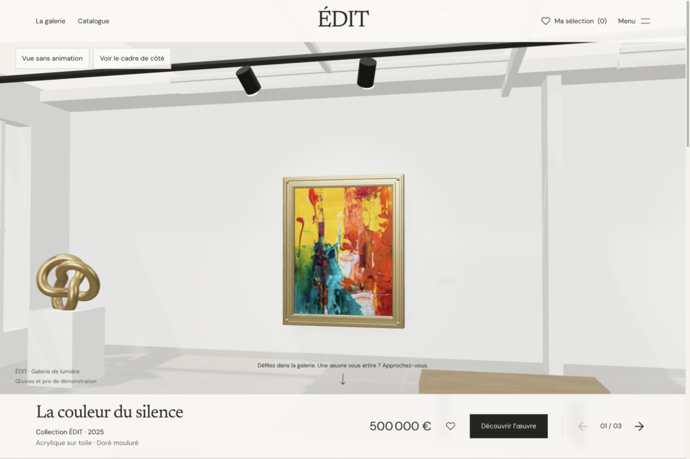

# ÉDIT

J’ai repris ÉDIT après une première V1 réalisée pendant mon entretien. Pour le deuxième, je voulais aller plus loin sur l’UX/UI et avoir quelque chose à montrer et à manipuler.

L’idée : entrer dans une galerie d’art lumineuse, passer d’un tableau à l’autre au scroll, puis s’arrêter sur une œuvre pour la regarder de près. J’ai gardé ÉDIT et choisi une direction plus luxe, avec une interface discrète et des œuvres présentées à partir de 500 000 €.

Ce dépôt accompagne ma présentation à Cauri. J’y montre le prototype, mais aussi les demandes, les retours et les choix qui l’ont fait évoluer.

[Essayer la démo](https://edit-art-gallery.vercel.app) · [Lire mes prompts](docs/prompts.md) · [Comprendre le code](docs/architecture.md)



## Ce que je voulais travailler

Au départ, j’ai demandé une direction artistique, puis des maquettes desktop et mobile avant de passer au prototype. Le fil conducteur est resté le même : donner envie de regarder une œuvre et laisser le temps de la découvrir.

Le parcours se joue en deux temps. Je scroll dans la galerie et une œuvre m’attire. Un premier clic ouvre sa fiche et rapproche la caméra. Un second clic sur le tableau permet de zoomer et de se déplacer dans l’image. La sortie reste visible pour reprendre la visite.

J’ai aussi voulu relier la mise en ligne d’une œuvre à son accrochage. Dans l’atelier, je peux importer un visuel et choisir son cadre. Le résultat apparaît directement dans la salle, puis ce choix reste attaché à la fiche publiée.

## Comment j’ai avancé

J’ai travaillé par retours successifs sur ce que je voyais. Quand un rendu allait dans la bonne direction, je le gardais et je précisais le point suivant. Quand il passait à côté de l’idée, je reformulais.

Le retour qui a le plus changé le projet est celui-ci :

> Là tu as utilisé la 3D que pour une section, je veux que ce soit l’expérience globale

La première scène fonctionnait, mais je voulais un décor de galerie, de la lumière, des ombres et de vrais cadres. À partir de là, la salle est devenue le fond de toute l’expérience. Le catalogue, la fiche et le configurateur s’ouvrent dans cette même scène.

| Ma demande | Ce qu’elle a fait évoluer |
| --- | --- |
| Poser une DA luxe et visualiser l’idée avant de coder | Maquettes desktop et mobile, salle blanche et lumineuse, typographie éditoriale |
| Passer au prototype avec des transitions au scroll | Parcours entre les tableaux dans une scène 3D |
| Travailler la fiche pour des œuvres à partir de 500 000 € | Histoire du tableau, informations, dossier et prise de contact |
| Faire de la 3D l’expérience globale | Salle persistante et cadres reliés au configurateur |
| Pouvoir s’arrêter et regarder les détails | Focus, zoom, déplacement dans l’œuvre et sortie plus visible |
| Repenser l’usage mobile | Pincement centré sous les doigts, commandes en bas et arrêt du scroll devant un tableau |

J’ai conservé les [prompts et le détail de ces retours](docs/prompts.md). Les [premières maquettes](docs/design.md) sont aussi dans le dépôt pour comparer l’intention et le prototype.

## Ma place et celle de l’IA

J’ai utilisé Codex pour m’aider à produire les maquettes, développer le prototype, écrire les tests et préparer cette documentation. Mes demandes fixent la direction, puis mes retours servent à corriger le rendu et le parcours.

Je préfère montrer cette façon de travailler telle qu’elle est. Le code a été développé avec une assistance IA ; les échanges permettent de voir ce que j’ai demandé, ce que j’ai remis en question et où j’ai voulu pousser le projet.

La première demande prévoyait un speedrun de huit heures. C’était le budget de travail visé, pas une durée mesurée que je peux certifier.

## Essayer le prototype

Depuis la galerie, je peux :

- défiler entre les œuvres et ouvrir leur fiche ;
- explorer un tableau avec le zoom et le glisser, puis revenir à la visite ;
- retrouver les œuvres enregistrées dans ma sélection ;
- ouvrir le menu, puis l’atelier, pour ajouter ou modifier une œuvre et choisir son cadre.

La fiche propose une demande d’acquisition liée au tableau. Elle prépare un message à relire et à copier. Aucun message n’est envoyé dans cette version.

Sur mobile, les fiches passent sous la scène. Les commandes de zoom et les sorties sont en bas, à portée du pouce. Le tableau reste visible pendant la lecture.

[Voir l’aperçu mobile](docs/images/gallery-mobile.jpg)

## Lancer le projet

J’ai gardé une base simple : HTML, CSS, JavaScript et Three.js 0.187.0. La bibliothèque, les polices et les images sont dans le dépôt. Le navigateur ne dépend pas d’un CDN pour charger la galerie.

Avec Python 3 :

```sh
python3 -m http.server 4173 --directory dist
```

Puis ouvrir [localhost:4173](http://localhost:4173). L’atelier est accessible à l’adresse `/#atelier`.

Pour les vérifications, j’utilise Node.js 22 :

```sh
npm run check
```

Le projet n’a pas de dépendance npm à installer. `dist/` contient directement les fichiers éditables servis au navigateur ; il n’y a pas de compilation.

## Ce qui est vérifié

Les tests couvrent les prix, les données du catalogue, les cadres et les proportions des visuels. Ils vérifient aussi le calcul des mouvements de caméra, l’ancrage du pincement, les limites du déplacement dans l’image et le contenu des demandes d’acquisition.

Les parcours ont été contrôlés dans un navigateur sur ordinateur et à des largeurs mobiles de 320 et 390 px, ainsi qu’en paysage. Le retour à la fiche conserve une demande en cours. La reprise de visite et le changement d’orientation conservent l’œuvre courante.

Je garde une limite claire : le ressenti tactile et les performances restent à vérifier sur de vrais téléphones iPhone et Android. Les tests de calcul et le redimensionnement du navigateur ne remplacent pas cette étape.

## Ce qui reste un prototype

Les œuvres et les favoris sont enregistrés dans le navigateur. Ils ne sont pas partagés entre visiteurs ou appareils. Changer de domaine crée un autre espace de stockage : les données de la première démo ne migrent pas vers Vercel.

Les titres, les textes et les prix du catalogue sont des exemples. Il n’y a pas de vente réelle, de paiement, de compte vendeur ou de dossier d’authenticité vérifié. Le formulaire d’acquisition n’a pas encore de destinataire configuré.

Le zoom utilise les pixels des visuels disponibles. Je ne peux pas montrer un détail absent du fichier d’origine. La salle adapte aussi la taille d’affichage des œuvres ; ce n’est pas une simulation à l’échelle de leurs dimensions en centimètres.

Pour la suite, je commencerais par les essais sur téléphone, puis par le stockage partagé et les rôles vendeur/acheteur. Un catalogue plus grand demanderait aussi de charger les œuvres progressivement.

## Organisation du dépôt

| Fichier ou dossier | Rôle |
| --- | --- |
| `dist/app.js` | Navigation, catalogue et atelier |
| `dist/world.js` | Scène persistante et interactions |
| `dist/gallery-scene.js` | Salle, matériaux, lumières et cadres en 3D |
| `dist/gallery-math.js` | Calculs du scroll, du zoom et des gestes |
| `dist/artwork.js` | Fiche et demande d’acquisition |
| `tests.mjs` | Tests sans dépendance externe |
| `docs/prompts.md` | Mes demandes et les décisions qui en découlent |
| `docs/architecture.md` | Fonctionnement technique et limites |
| `CONTRIBUTING.md` | Branches, commits et PR |

L’historique GitHub commence avec l’import du prototype fonctionnel. Les itérations précédentes sont retracées dans le journal des prompts ; je n’ai pas recréé de faux commits pour leur donner un historique après coup. La documentation et la préparation Vercel passent ensuite par une branche et une PR.

Les vérifications s’exécutent sur les PR et sur `main`. Vercel est relié au dépôt : les branches servent aux previews et `main` à la version de démonstration.

## Crédits

Les images viennent d’Unsplash. Les titres et prix du prototype ne décrivent pas les œuvres originales et ne leur attribuent pas un artiste fictif. Les sources figurent dans [les crédits des visuels](dist/assets/credits.html).

Three.js et RoomEnvironment sont distribués sous [licence MIT](dist/vendor/THREE-LICENSE.txt). Newsreader et DM Sans sont accompagnées de leurs licences SIL Open Font License dans `dist/assets/`.
