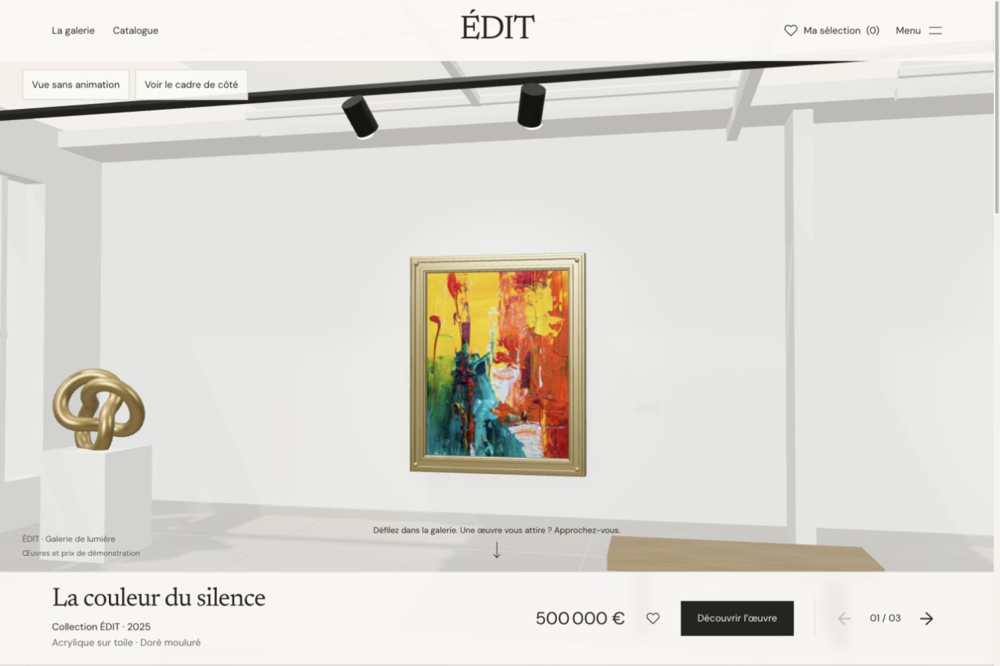

# La direction artistique

J’ai demandé les premières maquettes avant de passer au prototype. Je voulais pouvoir regarder l’idée sur desktop et sur mobile : une galerie claire, des œuvres encadrées et une interface qui laisse de la place au tableau.

## L’intention de départ

[Maquette mobile générée](images/concept-mobile.png)

Ces images sont des maquettes générées pour explorer la direction artistique. Elles servent de référence visuelle et ne prouvent pas le comportement du site.

## Le prototype

[Exploration d’une œuvre sur mobile](images/gallery-mobile.jpg)

J’ai gardé la salle lumineuse et les typographies Newsreader et DM Sans. Mes retours ont ensuite porté sur la présence du décor, la matière des cadres et la façon de s’approcher d’un tableau.

La 3D reste présente quand j’ouvre le catalogue, une fiche ou l’atelier. Sur mobile, je garde le tableau au-dessus de la fiche, puis je passe en exploration pour le regarder en plein écran. Les commandes de sortie restent en bas.

Le [document de design de la V1](archive/design-v1.md) est conservé comme archive. Il décrit le premier site, avant la galerie globale. Ses règles de mise en page et d’élévation ne décrivent pas la version actuelle.
